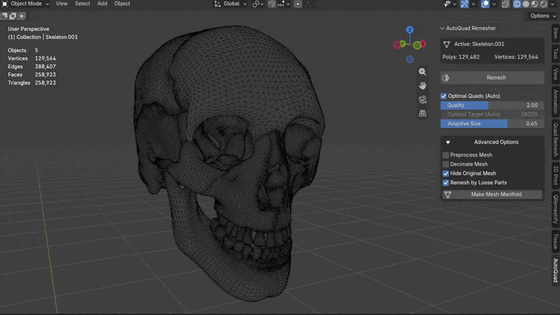
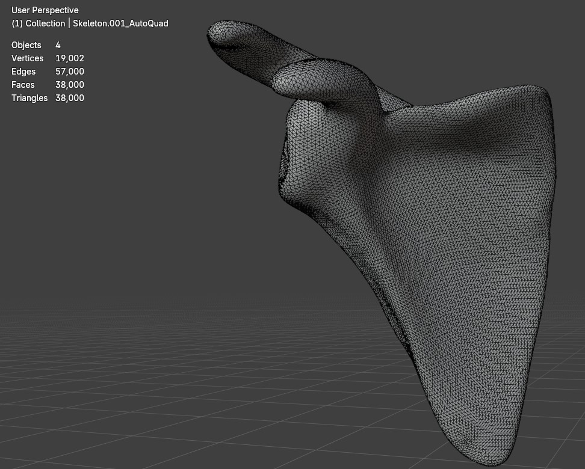
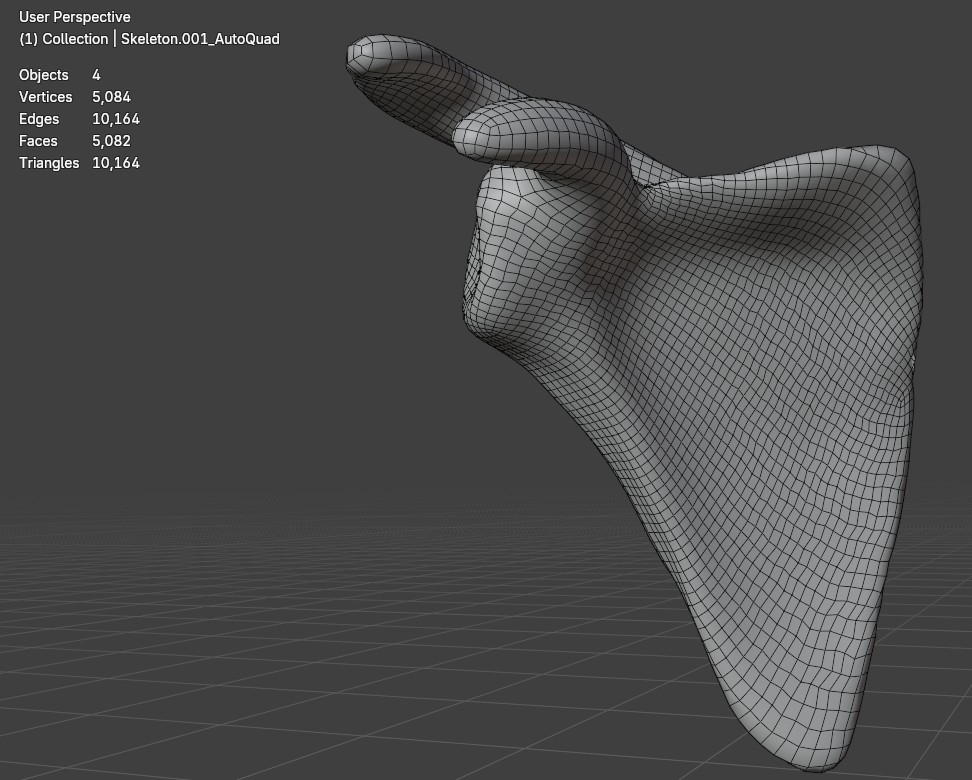

# AutoQuad Remesher

[](https://www.blender.org/)
[](LICENSE)
[]()
[]()

**AutoQuad Remesher** is a Blender add-on that automatically transforms complex 3D meshes into clean, high-quality quad topology while preserving surface details and sharp features. Designed for organic, hard-surface, and mechanical models, it makes professional automatic remeshing simple and efficient.

Developed by **Doctor Jana** for **Blender 4.2 LTS and newer** (including Blender 5.0 and 5.2+). It converts dense sculpts, photogrammetry 3D scans, CAD models, or uneven triangular meshes into production-ready quad geometry.

<p align="center">
  
</p>

---

## Before & After Showcase

| Original Input Scan (Dense / Triangles) | AutoQuad Clean Quad Topology (Result) |
| :---: | :---: |
|  |  |

---

## Clean, Uncluttered Interface

AutoQuad Remesher provides a clean, single-click interface designed for speed and simplicity:

```text
+------------------------------------------+
| Active: Suzanne_Sculpt                   |
| Polys: 7,872    | Vertices: 7,874        |
+------------------------------------------+
| [⚡ Remesh]                               |
+------------------------------------------+
| [x] Optimal Quads (Auto)                 |
| Quality: 1.00                            |
| Adaptive Size: 0.65                      |
+------------------------------------------+
| ▼ Advanced Options                       |
|   [ ] Preprocess Mesh (Auto-repair)      |
|   [ ] Decimate Mesh                      |
|   [x] Remesh by Loose Parts              |
|   [x] Hide Original Mesh                 |
+------------------------------------------+
```

When you click **Remesh**, a responsive, asynchronous loading indicator is displayed while the algorithm executes. You can cancel at any time with <kbd>ESC</kbd>, and the source mesh is automatically hidden so you immediately see the clean quad result.

---

## Key Features

- **Zero-Guesswork Optimal Quads:** Automatically evaluates discrete dihedral turning energy, mean surface curvature, and surface area to compute the mathematically optimal quad budget without manual trial and error.
- **Quality Multiplier:** Easily scale target density up or down (e.g. `2.0x` for 2x denser quads on high-frequency sculpts, or `0.5x` for lightweight real-time assets).
- **In-Memory Loose Parts Extraction:** Automatically segments complex multi-part meshes (e.g., characters with eyes/teeth, mechanical assemblies, multi-shell 3D scans) in memory, calculates tailored budgets per component, remeshes each shell independently, and seamlessly recombines them into a single unified quad mesh.
- **Scale-Invariant Geometry Normalization:** Automatically conditions sub-meter metric scans (e.g. human anatomy, dental models, jewelry) into optimal numerical space, eliminating floating-point underflow and false non-manifold errors.
- **Non-Blocking Asynchronous UI:** Generator-driven modal event loop updates live progress percentages in the status bar and animates the sidebar spinner without freezing Blender ("Not Responding"). Supports instant cancellation via <kbd>ESC</kbd>.
- **Dual-Engine Architecture:**
  - **Native C++ Acceleration:** Fast, parameterization-guided solver generating 95%+ regular quads.
  - **Discrete Differential Geometry Fallback:** Pure Python / BMesh topological patch solver using discrete shape operators and Weingarten curvature estimation.
- **Preprocess Mesh (Make Manifold):** Integrated 3D-Print repair logic to clean up non-manifold elements, remove duplicate vertices, fill holes, delete loose/interior geometry, and fix inverted normals.
- **Non-Destructive Workflow:** Your original source model is 100% preserved and untouched; newly generated quads are output as a clean `<Name>_AutoQuad` object.
- **100% Self-Contained:** Zero external dependencies or manual Python environment setups required. Runs completely offline.

---

## Installation & Download

### Method 1: Direct Download (From GitHub Releases Tag)

📦 **[Download autoquad_remesher-1.3.7.zip](https://github.com/doctorjana/AutoQuad-Remesher/releases/download/v1.3.7/autoquad_remesher-1.3.7.zip)** *(Official Release Asset, 76 KB)*  
🏷️ **[View GitHub Release v1.3.7](https://github.com/doctorjana/AutoQuad-Remesher/releases/tag/v1.3.7)**

1. In Blender, open **Edit > Preferences > Get Extensions** (or **Add-ons**).
2. Click the top-right chevron menu **(∨)** and select **Install from Disk...**
3. Select the downloaded `autoquad_remesher-1.3.7.zip` and confirm.
4. In the 3D Viewport, press <kbd>N</kbd> to open the sidebar and select the **AutoQuad** tab!

---

### Method 2: One-Click Script Editor Installation (No Manual Download)

You can install and enable AutoQuad automatically from inside Blender without downloading files manually:
1. Open Blender and switch to the **Scripting** workspace (or open a **Text Editor**).
2. Click **New**, paste the following snippet, and click **Run Script** (or press <kbd>Alt</kbd> + <kbd>P</kbd>):

```python
import os, tempfile, urllib.request, bpy

url = "https://github.com/doctorjana/AutoQuad-Remesher/releases/download/v1.3.7/autoquad_remesher-1.3.7.zip"
tmp_zip = os.path.join(tempfile.gettempdir(), "autoquad_remesher-1.3.7.zip")

print("Downloading AutoQuad Remesher from GitHub Releases...")
urllib.request.urlretrieve(url, tmp_zip)

if hasattr(bpy.ops.preferences, "extension_install"):
    bpy.ops.preferences.extension_install(filepath=tmp_zip, repo='user_default')
else:
    bpy.ops.preferences.addon_install(filepath=tmp_zip)
    bpy.ops.preferences.addon_enable(module="autoquad_remesher")

print("AutoQuad Remesher installed & ready! Open 3D Viewport sidebar (N) > AutoQuad tab.")
```

---

### Method 3: Copy-Paste Standalone Script (Run Directly in Script Editor)

If you prefer running the addon without installing zip packages:
1. Open [`autoquad_standalone.py`](https://github.com/doctorjana/AutoQuad-Remesher/blob/master/autoquad_standalone.py) in this repository and click **Copy raw file**.
2. In Blender, go to the **Scripting** tab, click **New**, paste the code, and press **Run Script** (<kbd>Alt</kbd> + <kbd>P</kbd>).
3. The **AutoQuad** sidebar panel will register and appear immediately in the 3D Viewport!

---

## Quick Start

1. Select your target mesh in **Object Mode**.
2. Press <kbd>N</kbd> to open the 3D Viewport sidebar and switch to the **AutoQuad** tab.
3. Enable **Optimal Quads (Auto)** or adjust **Target Quads** manually.
4. Click **Remesh**. The loading indicator will display live progress across parts, and your new quad mesh (`<Name>_AutoQuad`) will be created and activated with smooth shading.

---

## Automated Testing

AutoQuad includes an exhaustive 13-test automated regression suite:

```bash
# Validate extension manifest
blender --command extension validate .

# Run extension registration lifecycle tests
blender --background --python tests/test_registration.py

# Run geometry regression test suite
blender --background --python tests/test_regression.py
```

---

## License

This project is authored by **Doctor Jana** and licensed under the **GNU General Public License v3.0 or later** ([GPL-3.0-or-later](LICENSE)).
